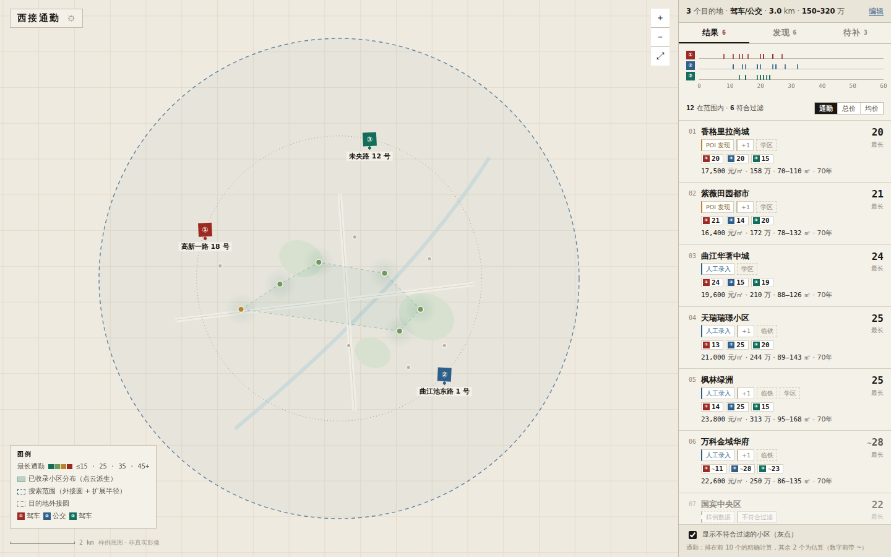
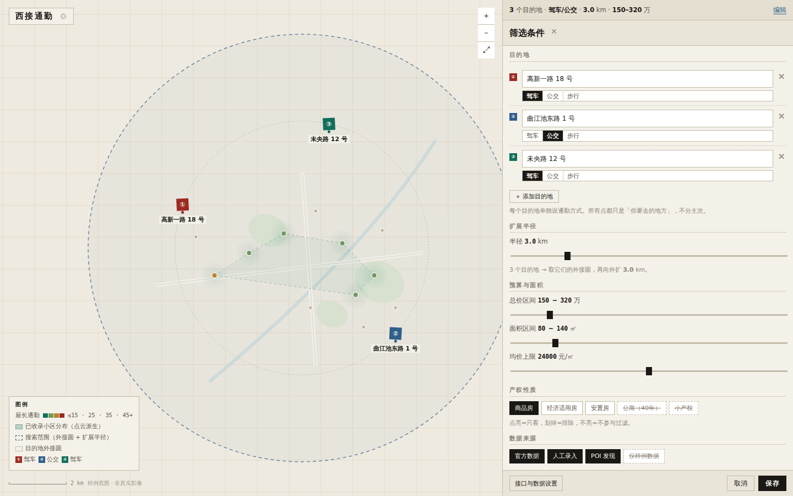
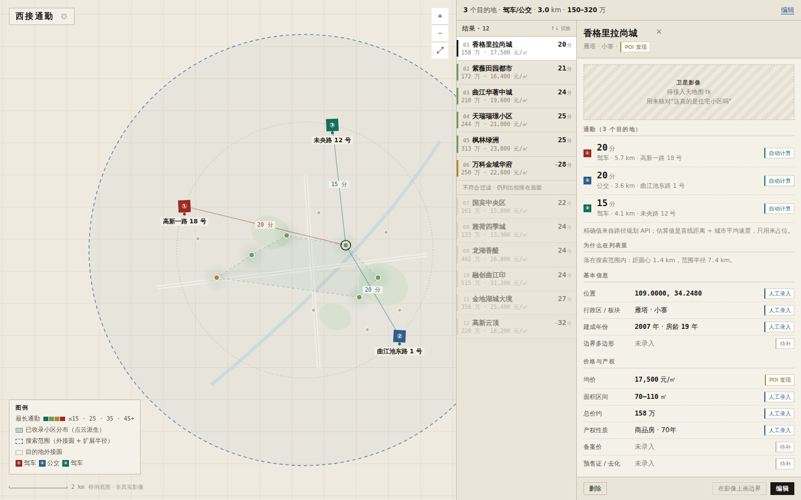
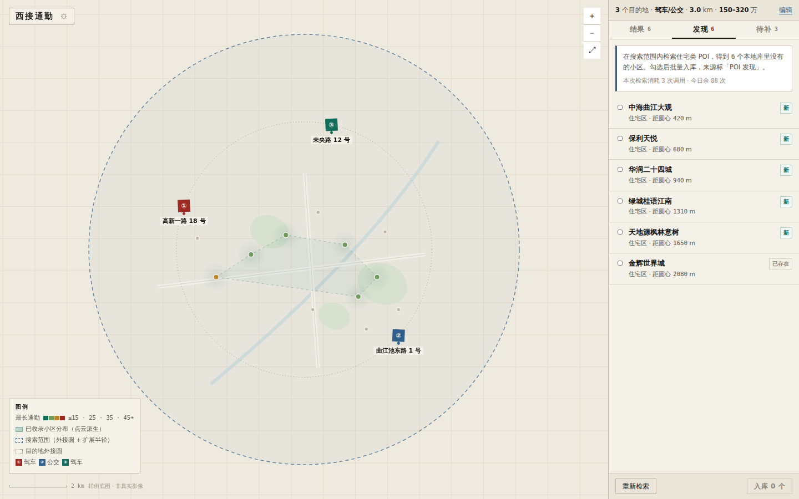
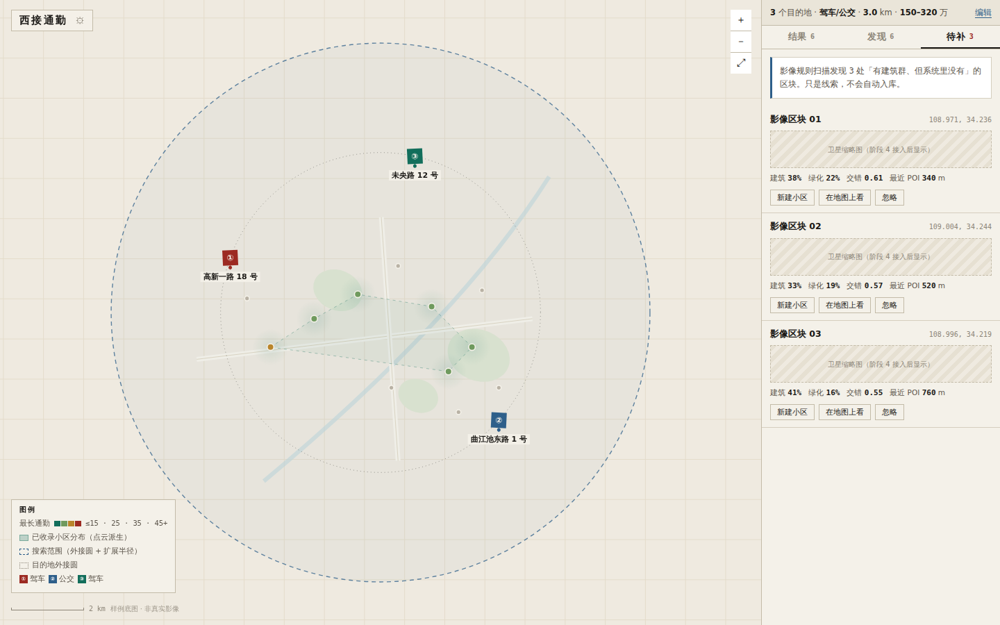
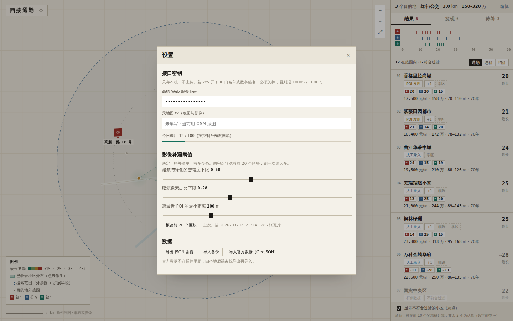

# 阶段 2 — UI 设计说明（v2 改版）

> 状态：draft-2，待你确认 | 原型：`extension/prototype/index.html`（双击用 Chrome 打开，**不联网、无外部资源**）
> v1 的双工作地点（A 公司 / B 家）已被 v2 的「目的地列表 + 扩展半径」取代。

---

## 0. 这一版改了什么

| 你的改动 | 落地方式 |
|---|---|
| 去掉最顶上那条 | 无顶栏。地图全屏，品牌缩成左上角一个小标记，设置藏在它的齿轮里 |
| 不区分家/公司 | 目的地就是「你要去的地方」，编号 ①②③，不分主次 |
| 地点列表可追加 | 默认 1 个，上限 5 个；每个目的地**单独设通勤方式**（驾车/公交/步行） |
| 不设通勤上限 | 通勤从「硬约束」变成**排序主指标**（按最长通勤排），不再有达标/超限判定 |
| 加扩展半径（km） | 1 个目的地 = 该点方圆 R km；N 个 = **最小外接圆 + 外扩 R km** |
| 条件收成一行 | 侧边栏第 1 行，常驻，点它展开编辑 |
| 第 2 行放原左侧面板 | 标签页 + 刻度尺 + 列表，整体挪到右侧 |
| 选中小区后面板变宽 | 侧边栏三态：列表 **344px** / 编辑 **528px** / 详情 **620px（两列）** |
| 选中后**列表不能消失** | 详情态 = Finder 列视图：左列压缩成 216px 的导航列表，右列 403px 是详情 |

---

## 1. 结构

```
┌────────────────────────────────────────────────────┬──────────────────┐
│                                                    │ ① 3 个目的地 · 半径│ ← 第 1 行（常驻一行）
│                                                    │   3.0 km · 150–320 │   点它→编辑
│                                                    ├──────────────────┤
│                    地图（全屏）                      │ 结果 6 发现 6 待补 3│ ← 第 2 行（原左侧面板）
│                                                    │ ① ▏▎▏  ▎  ▏   ▎   │   多泳道刻度尺
│  ┌ 西接通勤 ⚙                              ＋       │ ②  ▏ ▎▏▎   ▏      │
│  │                                        －       │ ③   ▏▎ ▏▏  ▎     │
│  │                                        ⤢       │ 12 在范围内 · 6 符合│
│  │                                                │ 01 小区卡片        │
│  └ 图例                              [比例尺]       │ …                 │
└────────────────────────────────────────────────────┴──────────────────┘
```

侧边栏三个状态（同一块区域，宽度动画 180ms）：

| 状态 | 宽度 | 布局 | 进入方式 |
|---|---|---|---|
| `list`（默认） | 344px | 条件摘要 + 标签页 + 刻度尺 + **完整卡片列表** | 启动 / 保存后返回 |
| `edit` | 528px | 单列表单（目的地、半径、预算、产权、来源） | 点第 1 行 |
| `detail` | **620px** | **两列**：左 216px 压缩列表 + 右 403px 详情 | 点卡片 / 地图点 |

`detail` 状态下左列仍然在，可以一路点下去换小区，**不用退回列表**；地图点也照旧可点。Esc 或详情右上角 `×` 收起详情回到 `list`。

---

## 2. 地图主界面（列表态）



**地图分四层，从下往上**

| 层 | 画法 | 含义 |
|---|---|---|
| 底图 | 纸色 + 街区网格 + 河 + 主干道 | 样例底图（真机接 OSM / 天地图） |
| 已收录小区分布 | 淡青色晕染 + 虚线凸包 | 手头数据覆盖到哪儿，一眼看出"这块我没数据" |
| 目的地外接圆 | 细点线圈 | 目的地点集的最小外接圆（1 个点时退化为点，不画） |
| **搜索范围** | 蓝图虚线圆 + 极淡填充 | **外接圆 + 扩展半径**，这是真正的取数边界 |
| 数据点 | 直径 9px 圆点，按最长通勤分 4 档上色 | ≤15 青绿 / ≤25 浅绿 / ≤35 芥黄 / >35 朱砂 |
| 标注 | ①②③ 印章 pin + 目的地地址；选中某小区时拉线到每个目的地并标分钟数 | |

**列表卡片**

```
01  香格里拉尚城                      20
    [POI 发现][+1][学区]              最长
    ① 20   ② 20   ③ 15
    17,500 元/㎡ · 158 万 · 70–110 ㎡ · 70年
```

- 右侧只有一个数字：**最长通勤**（排序主指标）。理由：多个目的地时，"最坏的那条通勤"决定生活质量，平均值会骗人。
- 下面一行 **每个目的地一枚小 pill**，颜色与地图 pin、刻度尺泳道一一对应。
- `~` 前缀 = 估算值（见 §5）。

**顶部那行条件摘要**：`3 个目的地 · 驾车/公交 · 3.0 km · 150–320 万` —— 只放能让你确认"我现在在看什么"的信息，其余留在编辑态。

---

## 3. 条件编辑（宽态）



```
┌ 筛选条件                        × ┐
│ 目的地                             │
│ ① [高新一路 18 号        ]     ✕  │
│    [驾车|公交|步行]                │
│ ② [曲江池东路 1 号      ]     ✕  │
│    [驾车|公交|步行]                │
│ ③ [未央路 12 号          ]     ✕  │
│    [驾车|公交|步行]                │
│ ＋ 添加目的地                      │
│ 每个目的地单独设通勤方式。所有点都  │
│ 只是「你要去的地方」，不分主次。    │
│                                    │
│ 扩展半径                           │
│ 半径 3.0 km  ━━●━━━━━━━━━         │
│ 3 个目的地 → 取它们的外接圆，再向   │
│ 外扩 3.0 km。                      │
│                                    │
│ 预算与面积（总价 / 面积 / 均价上限） │
│ 产权性质（三态 chip）               │
│ 数据来源（三态 chip）               │
├────────────────────────────────────┤
│ 接口与数据设置    [取消] [保存]     │
└────────────────────────────────────┘
```

**设计点**

1. **地点行的结构**：编号 → 地址输入 → 该点的通勤方式（seg）→ 删除。编号即地图 pin 与刻度尺泳道的编号，三处一致。
2. **「扩展半径」是滑杆不是输入框**：0–15 km 步进 0.1。理由：它是"试探"参数，拖着看圆变大变小比敲数字直观。
3. **半径说明跟着目的地点数变**：1 个点时写"就是该点方圆 X km"，≥2 个点时写"外接圆外扩 X km"。这条提示不能省，否则没人知道圆的算法。
4. **保存后回列表并重算**（0.7s 骨架屏）。
5. 「接口与数据设置」放在编辑态底部，而不是地图上再加一颗按钮——设置是低频动作，不该占地图空间。

**为什么「删除」按钮在只剩 1 个点时禁用**：需求是"默认 1 个，可追加"，那最少就是 1 个。禁用比删到 0 后报错好。

---

## 4. 小区详情（两列，Finder 列视图）



```
┌ ① 3 个目的地 · 驾车/公交 · 3.0 km · 150–320 万        编辑 ┐
├───────────────┬────────────────────────────────────────────┤
│ 结果 · 12  ↑↓  │ 香格里拉尚城                            ×  │
├───────────────┤ 雁塔 · 小寨  [POI 发现]                     │
│▌01 香格里拉 20 │ ┌ 卫星影像（待接 tk）───────────────────┐  │
│   158万·17,500│ 通勤（3 个目的地）                          │
│▌02 紫薇田园 21 │ ① 20 分  驾车·5.7km·高新一路   [自动计算]  │
│   172万·16,400│ ② 20 分  公交·3.6km·曲江池东路 [自动计算]  │
│▌03 曲江华著 24 │ ③ 15 分  驾车·4.1km·未央路     [自动计算]  │
│   210万·19,600│ 为什么在列表里                              │
│ …             │ 落在搜索范围内：距圆心 1.4km，半径 7.4km     │
│ ─ 不符合过滤 ─ │ 基本信息 / 价格与产权 / 补充画像 / 来源      │
│▌07 国宾中央 22 │                                            │
│   161万·15,800│                                            │
├───────────────┴────────────────────────────────────────────┤
│                              [删除][在影像上画边界][编辑]  │
└────────────────────────────────────────────────────────────┘
```

**为什么是两列而不是"列表消失换详情"**

比价和看通勤是**来回切换**的动作。列表一旦消失，你每看一个小区就要"返回→再点"两步；两列并排之后，右列换内容、左列位置不动，视线不会丢。这是 Finder 列视图的原始动机，用在这里刚好。

**左列（216px）保留什么、砍掉什么**

| 保留 | 理由 |
|---|---|
| 序号 `01…12` | 排序后仍能和地图对上 |
| 小区名（单行省略） | 唯一标识 |
| **最长通勤**（大号等宽数字）+ 通勤档位色条（左侧 3px） | 排序主指标，扫一眼就知道谁快 |
| 总价 + 均价（小号灰字第二行） | 比价必需，但降级为次要信息 |
| `~` 前缀 | 估算值标记照旧 |

| 砍掉 | 理由 |
|---|---|
| 来源 badge、标签、面积、产权年限 | 详情里都有；窄列里会挤成噪点 |
| 刻度尺泳道、标签页 | 看单个小区时不需要分布图；要换标签页按 Esc 回列表 |

**分组分隔线**：不符合过滤的小区排在最后，左列没有 badge 解释这个跳变，所以加一条 `不符合过滤 · 仍列出但排在后面` 的分隔行，避免"数字怎么突然跳了"的困惑。

**两列的滚动互相独立**：左列滚动不影响右列；选中行会 `scrollIntoView(nearest)` 保证可见。

**键盘**：左列 ↑↓ 直接换小区（不用先点再按），Enter/Space 选中，Esc 收起详情。

**这一屏是全产品的信任中心，三条规则不变**

1. **每个字段右侧一枚来源 badge**（官方数据 / 人工录入 / POI 发现 / 样例 / 待补）。缺失字段写"未录入"+`待补`，**不留白**。
2. **「为什么在列表里」** 用一句话解释入选原因；不符合过滤时直接列出「总价 402 万超出 150–320 万」这样的具体原因。
3. `在影像上画边界` 可见但禁用，title 写"阶段 4 上线"。

## 5. 没有通勤上限带来的两个必然后果

去掉上限之后，结果集可能从"几十个"变成"几百个"（尤其接入 POI 发现之后），而每个小区要对 N 个目的地各算一次路 —— 配额会爆。原型里用两条机制处理，需要你确认：

| 机制 | 做法 | 界面上怎么体现 |
|---|---|---|
| **半径优先剪枝** | 先用外接圆 + 半径把范围收死，范围外的小区不参与（地图上画成极淡灰点，说明"有数据但没落进来"） | 列表头「12 在范围内」；圆外点 |
| **精确 / 估算分层** | 按最长通勤排序，**只对前 10 个调路径规划 API**，其余用"直线距离 ÷ 城市平均速度"占位 | 估算值前带 `~`；详情 badge 写「直线估算」；列表底部一行小字说明"排在前 10 个的精确计算" |

> 代价说明：去掉上限后，"通勤不合格"这个筛选动作消失了，只能靠排序 + 半径。所以**半径参数的健康度直接决定结果质量**——半径太大会把通勤 60 分钟的房子也塞进来。这是把硬约束换成半径的必然结果，不是 bug。

---

## 6. 发现 / 待补（第 2 行的另外两个标签）



```
在搜索范围内检索住宅类 POI，得到 6 个本地库里没有的小区。
本次检索消耗 3 次调用 · 今日余 88 次
☐ 中海曲江大观  住宅区 · 距圆心 420m   [新]
☐ 金辉世界城    住宅区 · 距圆心 2080m  [已存在]
[重新检索]                    [入库 0 个]
```

"本次要花几次调用"必须在点之前说清——配额敏感的产品，这个提示就是它的礼貌。



待补清单每条显示触发它的三个特征值（建筑占比 / 绿化占比 / 交错度）和"离最近 POI 距离"，因为交错度 0.55 和 0.75 的可信度差很多。三个动作：新建 / 在地图上看 / 忽略。

---

## 7. 设置



从左上角品牌旁的齿轮进入，居中浮层。三段：接口密钥（含配额进度条）、影像补漏阈值（3 个滑杆 + 预览）、数据（导出/导入/官方数据导入）。

---

## 8. 来源标签规范（不变）

| 来源 | 文案 | 左条色 | 置信度 | 出现在 |
|---|---|---|---|---|
| `official` | 官方数据 | 朱砂 `#9C2A22` | 0.95 | 备案价、预售证、去化率 |
| `manual` | 人工录入 | 蓝图 `#2E5F8A` | 1.0 | 你亲手填/改的字段 |
| `poi` | POI 发现 | 芥黄 `#B9852B` | 0.7 | 高德周边搜索带来的名称与坐标 |
| `seed` | 样例数据 | 灰 + 虚线框 | 0.2 | 随插件带的演示数据 |
| （无） | 待补 | 灰 | — | 字段为空 |
| — | 自动计算 / 直线估算 | 青绿 / 灰 | — | 通勤值的计算方式（不是数据来源） |

**列表显示"最弱来源"**：有官方 + POI 两个来源时，列表显示 POI。默认假设数据不可信，全部字段都强才敢放心。

---

## 9. 配色与字体（沿用 v1 的判定）

| 角色 | 值 | 约束 |
|---|---|---|
| 纸 | `#F4F1E9` / `#EAE5D9` | 面板与底纸 |
| 墨 | `#1A1815` | 正文、主按钮、选中态 |
| 测绘图蓝 | `#2E5F8A` | **只用于图线与人工录入标签**，不做装饰 |
| 通勤 4 档 | `#126E5B` → `#6F9A5E` → `#B9852B` → `#9C2A22` | 与图例一一对应 |
| 目的地 5 色 | `#9C2A22` `#2E5F8A` `#126E5B` `#B9852B` `#6E5A8A` | ① 到 ⑤，地图 pin / 泳道 / pill 三处共用 |

字体三角色：标题宋体、正文黑体、**数字等宽 + tabular-nums**（分钟、元/㎡、㎡、万元、坐标全部走等宽，能上下对齐扫读）。

**颜色只表达语义**：没有渐变、没有彩色按钮、没有装饰色。

---

## 10. 状态与反馈

| 场景 | 反馈 |
|---|---|
| 保存后重算 | 列表 0.7s 骨架屏 |
| 范围内无小区 | 空态写明"把扩展半径调大，或去发现里检索"，给两条具体出路 |
| 不符合过滤的小区 | 降透明度 + `不符合过滤` badge；可在底部一键隐藏；**排序时永远排在符合的后面** |
| 配额将尽 | 顶部提示"今日剩 N 次 / 本次需要 M 次"（阶段 3 实现） |

---

## 11. 无障碍

- 刻度尺每个刻度、每张卡片、每个 chip 都是原生 `<button>` 或带 `tabindex` + Enter/Space 处理。
- `:focus-visible` 统一 2px 蓝图描边。
- 通勤档位同时用**颜色 + 数字 + 排序位置**三重编码，色弱可读。
- `prefers-reduced-motion` 下关闭全部过渡。
- 数字等宽对齐，200% 缩放下列表不重叠（面板固定宽 + 文本省略）。

---

## 12. 与阶段 3 的对应

| 原型区块 | 阶段 3 组件 | 数据来源 |
|---|---|---|
| 第 1 行条件摘要 | `CondLine` | `conditions` |
| 目的地行 | `DestRow` | `destinations` |
| 扩展半径滑杆 | `RadiusSlider` | `conditions.expand_radius_km` |
| 多泳道刻度尺 | `Lanes` | `communities.commute` |
| 卡片 | `EntryCard` | `filter.ts` |
| 详情各行 | `DetailSheet` → `FieldRow` | `Community` + `provenance` |
| 地图四层 | `MapCanvas` + `layers.ts` | `core/region.ts`（外接圆）/ `filter.ts` |
| 发现 / 待补 | `DiscoveryPanel` / `GapList` | `CandidateSite` / `GapItem` |

---

## 13. 需要你确认的 4 点

| # | 问题 | 我的建议 |
|---|---|---|
| U1 | 卡片只显示「最长通勤」够不够？要不要同时显示平均？ | 只显示最长。平均会掩盖"某一个目的地特别远"这个致命问题 |
| U2 | 详情态左列 216px 够不够？要不要把"面积"也加回去？ | 够。加面积会让第二行变成 3 段、更容易被省略号切掉；面积在详情里看 |
| U5 | 详情态要不要保留刻度尺/标签页？ | 不保留。要看分布或切到发现/待补，按 Esc 回列表；两列已经很满 |
| U3 | 半径滑杆范围 0–15 km、步进 0.1 合适吗？ | 合适。0 允许"就在点上"，15 km 覆盖跨区通勤 |
| U4 | 精确计算只做前 10 个，其余估算，能接受吗？ | 建议接受，否则接 POI 后发现几十个小区时配额会被瞬间打爆；详情里点一下可单独重算 |

另：原型里放了「切成 1 个目的地 / 3 个目的地」两个演示按钮（在编辑态最底部），只为让你对比两种形态；正式版会删掉。
